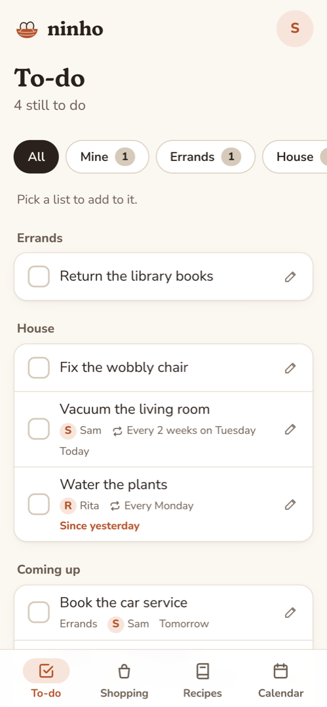
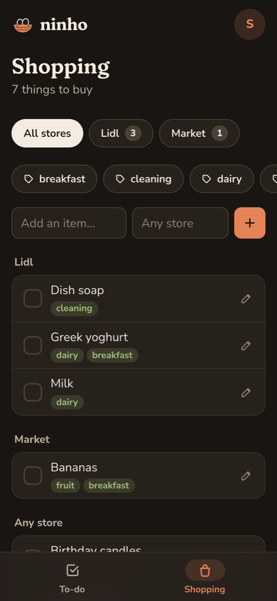
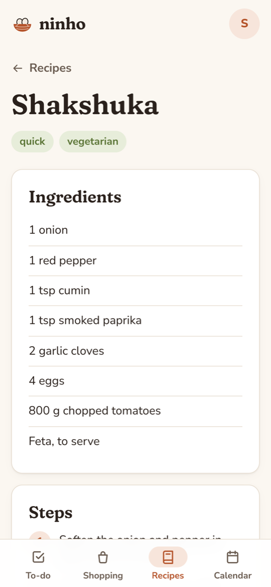
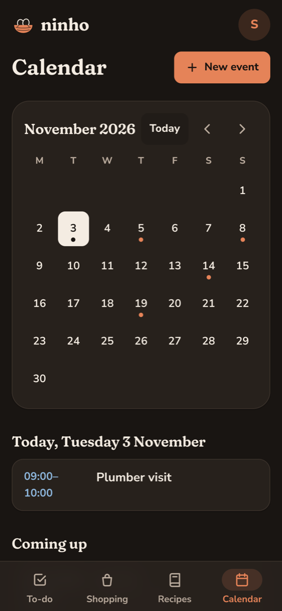
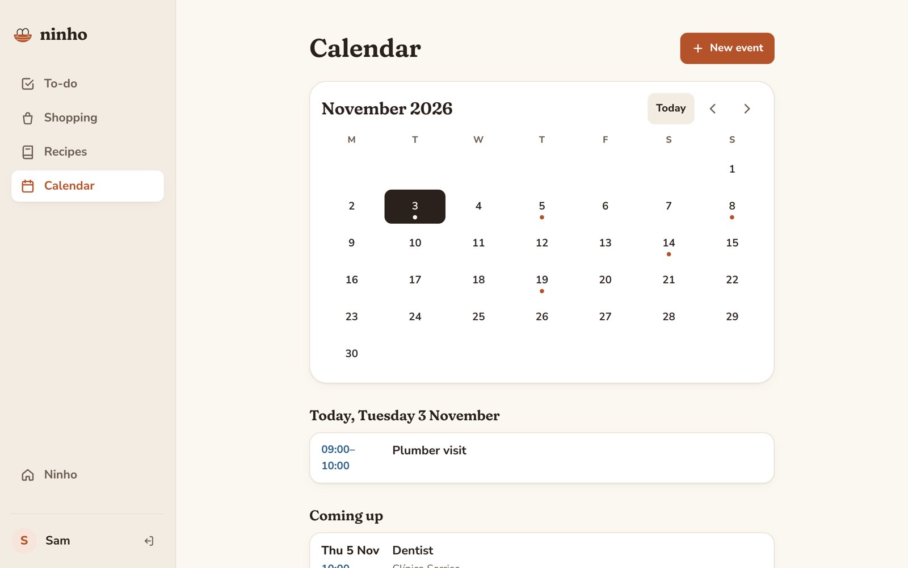
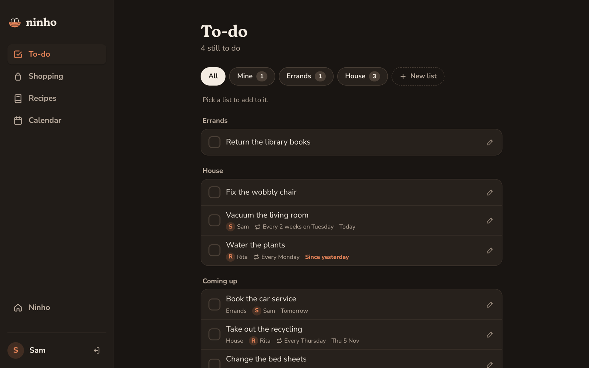

# Ninho

A self-hosted household app: shared to-do lists with repeating chores, a shopping list, recipes and a home calendar, running on your own server for the handful of people you live with.

*Ninho* is Portuguese for "nest".

<table>
    <tr>
        <td width="25%"></td>
        <td width="25%"></td>
        <td width="25%"></td>
        <td width="25%"></td>
    </tr>
    <tr>
        <td>Repeating chores, each with someone in charge</td>
        <td>Shopping by store and tag, in dark mode, with Recipes and Calendar turned off</td>
        <td>A recipe, ingredients sorted and steps numbered</td>
        <td>The home calendar, in dark mode</td>
    </tr>
    <tr>
        <td colspan="2"></td>
        <td colspan="2"></td>
    </tr>
    <tr>
        <td colspan="2">On a computer, the tabs move to a sidebar</td>
        <td colspan="2">Light and dark follow the device's setting</td>
    </tr>
</table>

## What's in it

- **To-dos**: as many lists as you like. Give a to-do to someone, set a due date, or make it repeat ("vacuum every 2 weeks") and it comes back on its own.
- **Shopping**: items with a supermarket, tags and a photo. Tick them into the cart while you shop, tap "Done shopping", and they move to your inventory. When something runs out, untick it and it's back on the list. Things you only buy once disappear after shopping.
- **Recipes**: ingredients, steps, tags, a photo and the link it came from.
- **Calendar**: the household's events, each one a tap away from Google Calendar or Apple Calendar.

Changes show up on everyone's phone straight away. Tabs you don't need can be turned off. It speaks English and European Portuguese, following each phone's language unless someone picks one on the **Ninho** page.

## How it works

- **Yours.** One Docker container and one SQLite file on your own machine. No cloud account, no email, no tracking.
- **For one household.** The first person to open Ninho looks after it and adds everyone else with a name and a password. There is no sign-up page.
- **Made for phones.** Add it to the home screen and it opens like an app. It works on a computer too.
- **Runs on small hardware.** Images for x86 and ARM64 (a Raspberry Pi with a 64-bit OS will do). It's meant for your home network or a VPN like Tailscale.

## Install

You need Docker with Compose. On your server:

```sh
mkdir ninho && cd ninho
curl -O https://raw.githubusercontent.com/aamadeira/ninho/main/docker-compose.yml
docker compose up -d
```

Set `TZ` in `docker-compose.yml` to your timezone first (see [Configure](#configure)).

Open `http://<server>:8090`. The first person to open it creates their account; from the **Ninho** page they add everyone else with a name and a first password.

On the phones: Share → Add to Home Screen on an iPhone, or the browser menu → Add to Home screen on Android.

## Update

```sh
docker compose pull && docker compose up -d
```

Database changes are applied on startup; your data stays in the `ninho-data` volume.

## Configure

Set these under `environment` in `docker-compose.yml`, then `docker compose up -d`:

- `DISABLED_FEATURES`: tabs to hide, comma separated. Any of `todos`, `shopping`, `recipes`, `calendar`. Example: `recipes,calendar`. New features are on by default.
- `TZ`: your timezone, for example `Europe/Lisbon`. Repeating to-dos use it to know what "today" is.
- `SECURE_COOKIE`: set to `true` once Ninho is served over HTTPS.

The logs show which features are on: `docker compose logs ninho | grep Features`.

## Locked out

If the person who looks after Ninho forgets their password, set a new one from the server:

```sh
docker compose exec ninho node dist/scripts/saveUser.js "Their name" 'a new long password'
```

With a name that doesn't exist yet, it adds that person instead.

## Back up

Everything lives in the `ninho-data` volume (one SQLite file):

```sh
docker compose stop && docker compose cp ninho:/srv/ninho/data ./ninho-backup && docker compose start
```

## HTTPS

Plain HTTP is fine on the home network and over Tailscale. If you later put it behind HTTPS (for example `tailscale serve`), set `SECURE_COOKIE=true` on the container.

## Develop

- `api/`: Express 5 + TypeScript, SQLite through Node's built-in `node:sqlite`, raw SQL, migrations in `api/migrations` (applied on startup).
- `web/`: React 19 + Vite + TanStack Query + React Router + CSS Modules.
- One container: the API serves the built web app and pushes changes to every open app through server-sent events (`/api/live`).

```sh
cd api && npm install
npm run dev        # API on :3000, database in api/data/; open the web app to create the first account

cd web && npm install
npm run dev        # http://localhost:5173, proxies /api and /auth to :3000
```

`cd api && npm test` runs the calendar export and repeating to-do tests.

The web app's text lives in `web/src/translations/` (`en.ts` is the reference). To add a language, copy `pt.ts`, translate it, and add the language to `web/src/lib/i18n.ts`; the build fails if a key is missing. To run your changes in Docker, `docker compose up -d --build` from a clone builds the image locally. Every push to `main` publishes `ghcr.io/aamadeira/ninho`.

## License

[MIT](LICENSE)
